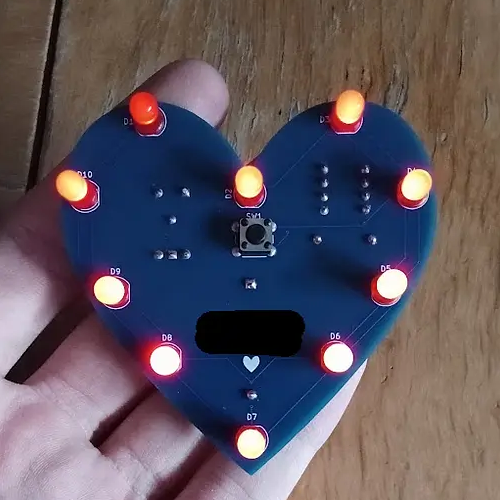
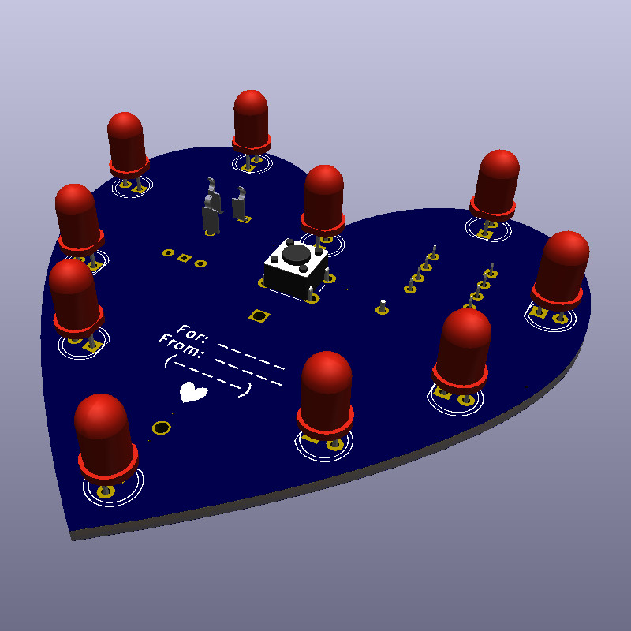
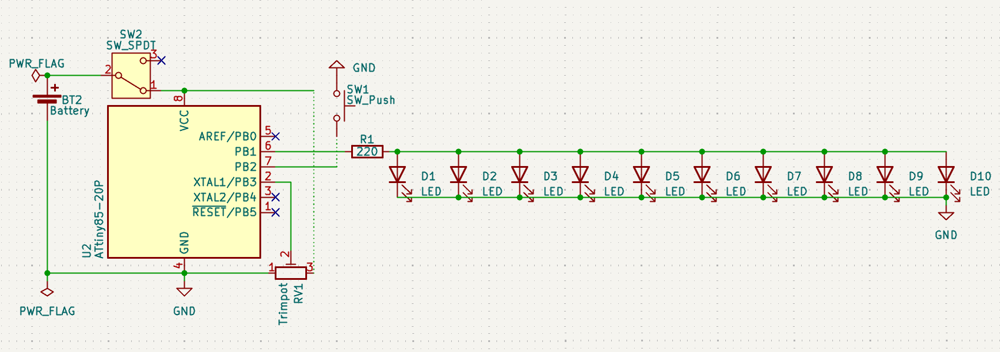
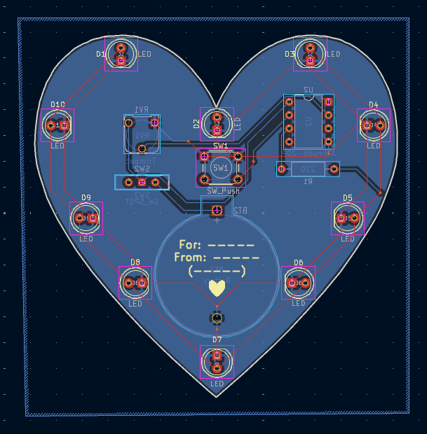

# ✨ **Project Luminescence** ✨

Project Luminescence is a custom heart shaped PCB with 10 red LEDs and a trimpot for analog brightness control.

Flip the switch on the back, then press the button on the front to cycle between off, on, and a slow fade mode. Use the trimpot on the back to tune the brightness.

I designed this as a birthday present for my girlfriend!

## Hardware:
- ATtiny85 microcontroller!
- Back-mounted CR2032
- 10x 5mm red LEDs around the PCB perimeter
- 6mm tactile button for mode cycling
- 1kΩ potentiometer for manual brightness tuning
- Back mounted SPDT slide switch as a master on/off switch
- 70x70mm, 2 layer blue PCB with white silkscreen and a ground pour

## CAD Model:
I opted for a pretty PCB instead of any form of case, so no 3D design files.

However, I was scared to omit this section, so `cad/pcb.step` is just the populated PCB, exported from KiCad.

## PCB:
This is my PCB. I designed it in KiCad!

## Firmware Features
- 50ms button debouncing
- Press the button to cycle OFF ⇨ ON ⇨ FADE 
- Gamma corrected smooth sine wave breathing
- Analog trimpot brightness control

## BOM
The full bill of materials with links and USD prices is in [`BOM.csv`](BOM.csv)

## Showcase
Check it out in action:

[Watch the showcase video](https://www.youtube.com/watch?v=EI6_KILgyM8)

### Thanks for voting :)